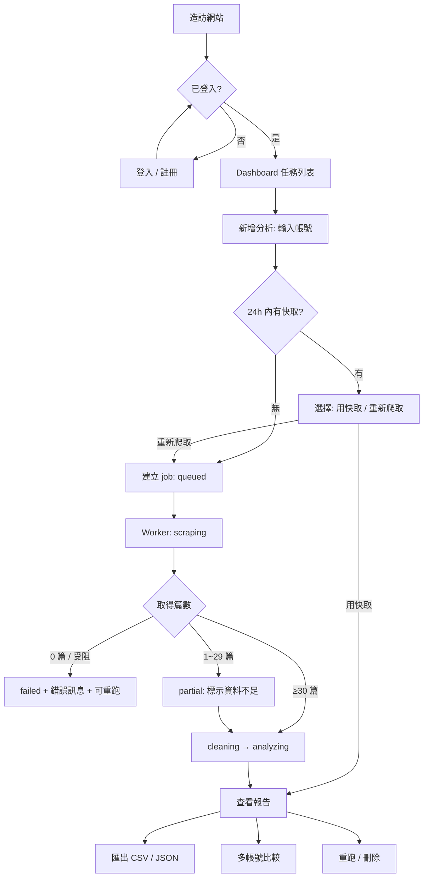

# PRD：Threads 帳號貼文分析工具（Threads Analyzer）

| 項目 | 內容 |
|---|---|
| 版本 | v0.2（已回覆 Q1–Q4，待最終確認） |
| 日期 | 2026-11-20 |
| 狀態 | 🟡 待確認 — 確認範圍、優先級、驗收標準後才進入開發 |
| 來源 | 考題文件「AI Vibe Coding 考題：Threads 帳號貼文爬取與數據分析」 |

> 變更規則：開發中任何新增或變更的需求，必須同步更新本文件第 2、6、8 章，並在文末〈變更紀錄〉記一筆。

---

## 0. 已確認的關鍵決策

| # | 決策 | 結論 | 理由／影響 |
|---|---|---|---|
| D1 | 資料來源 | **只用 Playwright 爬取 Threads，不使用 mock data**；先以未登入模式爬取，未登入取不到目標篇數時，**改用開發者自己的 Threads 帳號登入狀態**（Playwright `storageState`）續爬 | 符合考題「請用 playwright 進行爬取」。爬取受阻時任務標記失敗或部分完成，**不以假資料填補**。登入狀態只存在 Worker 的 secret，不進版控、不給前端。 |
| D2 | 三群組分組規則 | **互動分數三分位數**：`score = like + 2 × reply`，以 P33 / P67 切為高／中／低 | 回覆代表較深的互動，權重較高；規則簡單、可解釋、可驗收。 |
| D3 | 策略建議產生方式 | **Groq API（LLM）產生策略建議，規則模板作為 fallback** | 符合考題「LLM 建議」。Groq 呼叫失敗、逾時、回傳格式不合時自動退回規則模板，報告標示來源。API key 只放在 Worker。 |
| D4 | 專案位置 | `D:\project\threads-analyzer` | 獨立 Git repository，即為最終交付 repo。 |
| D5 | 架構 | **Next.js（Vercel）＋ Supabase ＋ GitHub Actions 執行 Python Worker（Playwright）** | Playwright 需要完整 Chromium、執行時間長，不適合放在 Vercel Serverless Function（套件大小與逾時限制）。GitHub Actions 免費、不需自備常駐主機、原生支援 Playwright；Next.js 建立任務後以 `workflow_dispatch` 觸發。同一份 Worker 程式也可本機以輪詢模式執行，供開發與備援。比較見 §7.1。 |
| D6 | 多帳號比較、CSV/JSON 匯出 | **PRD 中完整定義，實作優先級為 Should** | 考題將其列為加分項目（成果評估），但要求 PRD 必須定義；Must 完成後再做。 |

---

## 1. 產品目標與問題定義

### 1.1 要解決的問題
內容團隊想評估某個 Threads 帳號「哪些貼文表現好、為什麼好、接下來該怎麼發」，但目前只能手動滑頁面、憑感覺判斷，沒有可重複、可比較的數據。

### 1.2 目標使用者
- **主要**：內容／社群行銷人員，需要評估自家或競品帳號的發文表現。
- **次要**：出題評審，需要能登入、建立任務、驗證結果。

### 1.3 使用情境
1. 行銷人員輸入競品帳號 `@example`，10 分鐘內拿到近 30+ 篇貼文的互動報告。
2. 比較 2–3 個同類帳號的平均互動、發文時段與貼文類型差異。
3. 匯出 CSV / JSON 給其他工具做進一步分析。

### 1.4 產品目標（可量測）
| 目標 | 指標 |
|---|---|
| G1 取得資料 | 公開帳號單次任務取得 ≥ 30 篇貼文的成功率 ≥ 80%（以 5 個測試帳號驗證） |
| G2 產出報告 | 任務完成後報告包含：總覽指標、Top 5、≥ 2 張圖表、≥ 3 點觀察、三群組 NLP 分析 |
| G3 資料隔離 | 使用者 A 無法透過 UI 或 Supabase API 讀到使用者 B 的任何任務／貼文／結果 |

### 1.5 本次不處理（Out of Scope）
- 私人帳號、需登入才看得到的貼文。
- **曝光數（views）**：Threads 僅帳號本人可見，公開頁面無法取得 → 欄位保留但值為 `NULL`，見 §4、§5。
- 即時監控／排程自動重抓。
- 發文、回覆等寫入 Threads 的操作。
- 留言內容（replies 的文字）爬取與分析。
- 圖片／影片內容辨識。
- 付費方案、團隊共用、多語系 UI。

---

## 2. 功能描述

> 格式：目的／觸發／輸入／處理流程／輸出／使用者可見狀態。優先級見 §8。

### F1 使用者註冊／登入與權限控管（Must）
- **目的**：只有登入者能建立與查看自己的分析。
- **觸發**：造訪任何 `/dashboard/*` 頁面，或點「登入」。
- **輸入**：Email ＋ Password（Supabase Auth）。
- **處理流程**：
  1. 註冊 → Supabase 寄驗證信 → 驗證後可登入。
  2. 登入成功 → 建立 session（cookie）→ 導向 `/dashboard`。
  3. Next.js middleware 檢查 session，未登入存取受保護頁 → 302 導向 `/login?next=<原路徑>`。
  4. 首次登入時以 DB trigger 建立 `profiles` 紀錄。
- **輸出**：登入狀態、使用者 Email 顯示於右上角、登出按鈕。
- **使用者可見狀態**：`未登入` / `登入中…` / `登入失敗（訊息）` / `已登入`。

### F2 建立分析任務（Must）
- **目的**：輸入帳號，排入爬取與分析流程。
- **觸發**：Dashboard 點「新增分析」並送出。
- **輸入**：
  - `target`：Threads username（`example`、`@example`）或 URL（`https://www.threads.com/@example`、`threads.net` 亦接受）。
  - `max_posts`：目標篇數，預設 30，範圍 30–100。
- **處理流程**：
  1. 前端正規化 → 抽出 username（規則：`^[A-Za-z0-9._]{1,30}$`）。
  2. 檢查重複任務（§5 E7）。
  3. 寫入 `analysis_jobs`，`status = queued`。
  4. Next.js Route Handler（伺服器端）呼叫 GitHub API `workflow_dispatch`，傳入 `job_id`，觸發 Worker workflow；觸發失敗則任務維持 `queued`，由本機輪詢模式 Worker 或使用者「重新觸發」處理（§5 E9）。
  5. Worker 以 `UPDATE … SET status='scraping' WHERE id=$1 AND status='queued' RETURNING` 搶鎖，避免重複執行。
- **輸出**：任務 ID，導向任務詳情頁。
- **使用者可見狀態**：`排隊中` → `爬取中（已取得 n 篇）` → `分析中` → `完成` / `部分完成` / `失敗`。前端每 5 秒輪詢或用 Supabase Realtime 更新。

### F3 資料爬取（Must）
- **目的**：以 Playwright 取得該帳號最近貼文。
- **觸發**：Worker 領到 `queued` 任務。
- **輸入**：username、max_posts。
- **處理流程**：
  1. 開啟 `https://www.threads.com/@{username}`（headless Chromium，固定 UA、zh-TW locale）。
  2. 判斷頁面狀態：帳號不存在／私人帳號／正常（§5 E2）。
  3. 擷取帳號資訊：顯示名稱、粉絲數。
  4. **分批捲動**：每次捲動後等待新貼文出現，每批解析一次 DOM；連續 3 次捲動無新貼文即停止。
  4a. **登入 fallback**：若未登入模式停止時篇數 < `max_posts`，或遇到登入牆，且 Worker 有設定 `THREADS_STORAGE_STATE`，則以登入狀態重開瀏覽器、從頭捲動續爬（已取得的貼文以 `post_id` 去重）。`analysis_jobs.scrape_mode` 記錄 `anonymous` / `authenticated`，報告中顯示。登入狀態失效（被導向登入頁）→ log `warn`，以已取得資料繼續（§5 E12）。
  5. 每篇擷取：貼文 ID／URL、發文時間（`<time datetime>`）、文字內容、like、reply、repost、quote 數。
  6. 每批寫入 `posts`（upsert，以 `(job_id, post_id)` 去重），更新 `scraped_count`。
  7. 每個網路／解析步驟 retry：最多 3 次，指數退避 2s / 4s / 8s。
  8. 每頁動作間隔 1.5–3 秒隨機延遲，降低對服務的負擔。
- **輸出**：`posts` 原始資料（含 `raw_json`）、爬取 log（`job_logs`）。
- **使用者可見狀態**：進度「已取得 n / 目標 N 篇」、目前步驟、錯誤訊息。

> **合法性說明**（README 也要寫）：只讀取公開帳號的貼文；預設以未登入狀態讀取，必要時使用開發者本人帳號的正常登入狀態（不使用他人帳號、不破解驗證、不繞過私人帳號限制、不大量併發）；遵守低頻存取。使用登入狀態會讓爬取行為與開發者帳號綁定，有被 Threads 限制的風險，README 需提醒。Meta 服務條款原則上限制自動化蒐集，本專案僅供學術／考題示範用途，不做商業轉售。

### F4 資料清理（Must）
- **觸發**：爬取結束（≥ 1 篇）後 Worker 自動執行。
- **處理流程**：
  1. 去重：以 `post_id` 去重；無 ID 時以 `(published_at, text 前 50 字)` 去重。
  2. 缺失欄位：數字欄位解析失敗 → `NULL` 並記 `missing_fields`；計算時 `NULL` 不當 0，平均以有效值計算並顯示樣本數。
  3. 數字格式：`1.2萬`、`1.2K`、`3,456` → 整數。
  4. 時區：一律存 UTC（`timestamptz`），顯示與時段分析用 `Asia/Taipei`。
  5. 文字特徵：字數（去除 URL 後的字元數）、hashtag 數、mention 數、URL 數、emoji 數。
  6. 貼文類型（可複選標籤）：`純文字`、`含連結`、`含 hashtag`、`含 mention`；無任何標籤者為純文字。
  7. 異常值：以 IQR（> Q3 + 3×IQR）標記 `is_outlier`；圖表與平均同時提供「含／不含異常值」兩種數值。
- **輸出**：`posts` 清理後欄位。

### F5 數據分析（Must）
- **觸發**：清理完成。
- **指標定義**：
  | 指標 | 定義 |
  |---|---|
  | 總互動 `engagement` | `like + reply + repost + quote` |
  | 互動率 `engagement_rate` | `engagement / followers_count`（因曝光數不可得，以粉絲數為分母；粉絲數取不到則不計算並註明） |
  | 互動分數 `score` | `like + 2 × reply`（用於三群組） |
  | 平均值 | 平均 like / reply / repost / quote、中位數一併提供 |
- **產出**：
  1. 總覽：貼文數、時間範圍、平均／中位數 like、reply、repost、平均互動率。
  2. Top 5 互動率貼文。
  3. 發文時間分布：星期 × 小時熱度、各時段平均互動。
  4. 文字長度與互動：分箱（0–50、51–150、151–300、300+）平均互動＋ Spearman 相關係數。
  5. 常見關鍵字與 hashtag Top 20（中文以 jieba 斷詞＋停用詞表）。
  6. 貼文類型分布與各類型平均互動。
- **輸出**：寫入 `analysis_results.summary`（JSON）。

### F6 三群組 NLP 成敗分析（Must）
- **處理流程**：
  1. 依 `score` 的 P33 / P67 分為 `high`、`mid`、`low`（樣本 < 9 篇不分組，§5 E3）。
  2. 每組依 score 排序取代表貼文：high 取最高 5 篇、low 取最低 5 篇、mid 取最接近中位數 5 篇（不足 5 篇取全部，至少 3 篇）。
  3. 對每組套用**同一套 NLP 方法**：
     - 關鍵字：TF-IDF（以全帳號貼文為語料）取每組 Top 10 特徵詞。
     - 文字特徵：平均字數、問句比例（含「？」）、emoji 比例、hashtag／mention／連結比例。
     - 情緒傾向：以中文情緒詞典（如 NTUSD）計算正負向比例。
  4. 規則模板比對 high vs low 的差異，產出「成功因素」與「失敗因素」敘述（例：high 組問句比例 60% vs low 組 10% → 「以提問結尾的貼文較容易引發回覆」）。
- **輸出**：`analysis_results.groups`（JSON），每組含代表貼文、特徵數值、敘述。

### F7 報告 Dashboard（Must）
- **觸發**：任務 `完成` 或 `部分完成` 後進入任務詳情頁。
- **內容**：
  1. 總覽指標卡片。
  2. Top posts 表格（時間、內容摘要、like、reply、repost、互動率、連結）。
  3. 圖表 ≥ 2 張（Must：發文時段熱度圖、貼文類型平均互動長條圖；Should：文字長度 vs 互動散佈圖、關鍵字長條圖）。
  4. 三群組 NLP 分析區塊。
  5. 內容策略觀察 ≥ 3 點（規則模板產生，每點標示「觀察（數據）」與「推測／建議」，並附驗證方法）。
  5a. LLM 策略建議（F12，Groq 產生；fallback 時標示「規則模板產生」）。
  6. 資料限制提示：樣本數、缺失欄位、無曝光數、是否部分完成。

### F8 查看、重跑與刪除任務（Must）
- **查看**：`/dashboard` 列出自己的任務（帳號、建立時間、狀態、貼文數），可依時間排序。
- **重跑**：在完成／失敗任務點「重跑」→ 建立新 job（`parent_job_id` 指向原任務），保留舊結果供對照。
- **刪除**：二次確認後刪除任務，連帶刪除 posts / results / logs（`ON DELETE CASCADE`）。進行中任務需先取消（`status = cancelled`，Worker 每批檢查並中止）。

### F9 多帳號比較（Should，加分項目）
- **輸入**：勾選 2–4 個自己已完成的任務。
- **輸出**：並排比較表（平均互動、互動率、發文頻率、類型分布）＋ 1 張分組長條圖。
- **規則**：只能選自己的任務；同帳號多次任務以使用者勾選為準。

### F10 匯出 CSV / JSON（Should，加分項目）
- 任務頁提供「下載貼文 CSV」「下載完整 JSON（貼文＋分析結果）」。
- CSV 為 UTF-8 with BOM（Excel 開啟中文不亂碼）。
- 透過 Next.js Route Handler 以使用者 session 查詢，受 RLS 保護。

### F11 快取（Should）
- 同一使用者、同一 username，24 小時內已有 `completed` 任務 → 提示「使用快取結果」或「強制重新爬取」。

### F12 LLM 策略建議（Must，Groq API）
- **目的**：把分析數據轉成具體、可執行的內容策略建議。
- **觸發**：F6 完成後由 Worker 執行。
- **輸入**：`summary`、`top_posts`（只送文字前 200 字與數字）、`groups` 的 JSON；不送使用者個資。
- **處理流程**：
  1. `StrategyGenerator` 介面，兩個實作：`GroqGenerator`（主要）、`RuleBasedGenerator`（fallback）。
  2. 呼叫 Groq Chat Completions（OpenAI 相容端點），模型由 `GROQ_MODEL` 設定，`temperature = 0.3`，要求 JSON 輸出。
  3. 提示詞要求：每條建議必須引用報告中實際出現的數字作為依據，區分「觀察」與「推測」，附驗證方法、優先級（P1–P3）與建議執行時程。
  4. 驗證回傳：JSON schema 檢查（3–5 條，每條含 `observation / hypothesis / action / validation / priority / timeline`）；檢查引用數字是否存在於 `summary`（防幻覺），不合格的條目捨棄。
  5. 逾時 20 秒、HTTP 429/5xx retry 2 次；仍失敗或合格條目 < 3 → 改用 `RuleBasedGenerator`。
- **輸出**：`analysis_results.insights`，`generator` 記錄 `groq:<model>` 或 `rule_based_v1`。
- **使用者可見狀態**：建議區塊標示來源（「AI 產生（Groq）」或「規則模板產生」）與免責說明「AI 建議僅供參考，請以驗證方法確認」。

---

## 3. 使用者流程

### User Stories
1. 身為行銷人員，我想用 Email 登入，才能保存我的分析紀錄。
2. 身為行銷人員，我想輸入一個帳號就自動取得 30+ 篇貼文，不用手動整理。
3. 身為行銷人員，我想看到任務進度，知道還要等多久或為何失敗。
4. 身為行銷人員，我想看到高／中／低互動貼文的差異原因，知道下一篇怎麼寫。
5. 身為行銷人員，我想並排比較多個帳號。
6. 身為行銷人員，我想匯出資料給其他工具。
7. 身為使用者，我不希望其他人看到我分析了哪些帳號。

---

## 4. 資料與權限

### 4.1 資料表

**profiles**（使用者資料）
| 欄位 | 型別 | 必填 | 說明 |
|---|---|---|---|
| id | uuid PK | ✔ | = `auth.users.id` |
| email | text | ✔ | |
| display_name | text | | |
| created_at | timestamptz | ✔ | default now() |

**analysis_jobs**（分析任務）
| 欄位 | 型別 | 必填 | 說明 |
|---|---|---|---|
| id | uuid PK | ✔ | |
| user_id | uuid FK → profiles.id | ✔ | |
| target_username | text | ✔ | 正規化後小寫 |
| max_posts | int | ✔ | 30–100 |
| status | text | ✔ | `queued / scraping / cleaning / analyzing / completed / partial / failed / cancelled` |
| scraped_count | int | ✔ | default 0 |
| error_code | text | | 見 §5 |
| error_message | text | | 使用者可讀訊息 |
| attempt | int | ✔ | 已重試次數 |
| parent_job_id | uuid FK → analysis_jobs.id | | 重跑來源 |
| account_meta | jsonb | | 顯示名稱、粉絲數 |
| scrape_mode | text | | `anonymous / authenticated` |
| run_url | text | | GitHub Actions 執行頁網址（除錯用，僅自己可見） |
| created_at / started_at / finished_at | timestamptz | | |

索引：`(user_id, created_at desc)`；部分唯一索引 `(user_id, target_username) WHERE status IN ('queued','scraping','cleaning','analyzing')` 防重複進行中任務。

**posts**（貼文資料）
| 欄位 | 型別 | 必填 | 說明 |
|---|---|---|---|
| id | bigserial PK | ✔ | |
| job_id | uuid FK → analysis_jobs.id ON DELETE CASCADE | ✔ | |
| user_id | uuid | ✔ | 冗餘，方便 RLS |
| post_id | text | ✔ | Threads 貼文代碼；UNIQUE(job_id, post_id) |
| post_url | text | ✔ | |
| published_at | timestamptz | | UTC |
| text | text | | 可為空字串（純圖片） |
| views | int | | **永遠 NULL**（公開頁不可得） |
| likes / replies / reposts / quotes | int | | 解析失敗為 NULL |
| char_count / hashtag_count / mention_count / url_count / emoji_count | int | | 清理後填 |
| post_types | text[] | | |
| hashtags / mentions | text[] | | |
| engagement / engagement_rate / score | numeric | | |
| group_label | text | | `high / mid / low` |
| is_outlier | bool | | |
| missing_fields | text[] | | |
| raw_json | jsonb | | 原始擷取資料 |
| scraped_at | timestamptz | ✔ | |

**analysis_results**（彙總分析結果）
| 欄位 | 型別 | 必填 | 說明 |
|---|---|---|---|
| job_id | uuid PK/FK ON DELETE CASCADE | ✔ | 一任務一筆 |
| user_id | uuid | ✔ | |
| summary | jsonb | ✔ | 總覽、時段、長度、關鍵字、類型 |
| top_posts | jsonb | ✔ | |
| groups | jsonb | | 三群組 NLP；樣本不足為 NULL |
| insights | jsonb | ✔ | 觀察／推測／建議／驗證方法／優先級 |
| generator | text | ✔ | `groq:<model>` 或 `rule_based_v1` |
| created_at | timestamptz | ✔ | |

**job_logs**（爬取／分析日誌）
| 欄位 | 型別 | 說明 |
|---|---|---|
| id | bigserial | |
| job_id | uuid FK CASCADE | |
| user_id | uuid | |
| level | text | `info / warn / error` |
| step | text | `scrape / clean / analyze` |
| message | text | |
| created_at | timestamptz | |

### 4.2 關聯
`profiles 1—N analysis_jobs 1—N posts`；`analysis_jobs 1—1 analysis_results`；`analysis_jobs 1—N job_logs`。

### 4.3 資料來源
| 資料 | 來源 |
|---|---|
| profiles | Supabase Auth trigger |
| analysis_jobs | 使用者在 Web 建立；Worker 更新狀態 |
| posts / job_logs | Worker（Playwright 爬取＋清理） |
| analysis_results | Worker（Python 分析） |

### 4.4 權限（RLS）
| 角色 | profiles | analysis_jobs | posts / results / logs |
|---|---|---|---|
| 未登入（anon） | ✘ | ✘ | ✘ |
| 已登入使用者 | 只讀寫自己的列 | 讀／新增／刪除自己的（`user_id = auth.uid()`）；可把自己的任務改為 `cancelled`；其他欄位不可改 | **只讀**自己的 |
| Worker（service_role） | 讀 | 讀寫全部 | 讀寫全部 |

- 所有表啟用 RLS，`service_role` key 只存在 Worker 環境，**絕不放前端**。
- 前端只用 anon key ＋ 使用者 session。

---

## 5. 例外情境

| 代碼 | 情境 | 偵測方式 | 使用者看到的訊息 | 系統行為 |
|---|---|---|---|---|
| E1 | 登入失敗 | Supabase Auth 回錯 | 「Email 或密碼錯誤」／「請先完成信箱驗證」 | 不洩漏帳號是否存在；連續 5 次失敗由 Supabase rate limit 處理 |
| E2a | 帳號不存在 | 頁面顯示找不到使用者 / 404 | 「找不到帳號 @xxx，請確認拼字」 | `failed`，`ACCOUNT_NOT_FOUND`，不 retry |
| E2b | 私人帳號 | 頁面顯示私人 | 「@xxx 為私人帳號，無法分析」 | `failed`，`ACCOUNT_PRIVATE`，不 retry |
| E2c | 輸入格式錯誤 | 前端正規表達式 | 「請輸入有效的 username 或 Threads 網址」 | 不建立任務 |
| E3 | 資料不足 | 取得 1–29 篇 | 「僅取得 n 篇（目標 30），結果可信度較低」 | `partial`；仍做分析；< 9 篇不做三群組，< 3 篇不做 Top 5 以外分析 |
| E4 | 爬取受阻 | 出現登入牆、驗證、HTTP 429、連續 3 次捲動 0 新貼文且 0 篇 | 「Threads 暫時限制存取，請稍後重跑」 | retry 3 次（退避）→ `failed`，`SCRAPE_BLOCKED`；**不以 mock 替代**；已取得的貼文保留並轉 `partial` |
| E5 | 欄位缺失 | DOM 選擇器找不到 | 報告中標示「n 篇缺少 like 數」 | 該欄 NULL、記 `missing_fields`、warn log；選擇器全部失敗（版面改版）→ `failed`，`PARSER_BROKEN` |
| E6 | 逾時 | 單頁載入 > 30s、整體任務 > 10 分鐘 | 「抓取逾時，已保存 n 篇」 | 單頁 retry 3 次；整體逾時 → 有資料為 `partial`，無資料為 `failed`，`TIMEOUT` |
| E7 | 重複任務 | 部分唯一索引衝突 | 「@xxx 已在分析中，前往查看」 | 不建新任務，導向進行中任務 |
| E8 | 分析失敗 | Python 例外 | 「分析失敗，原始貼文已保存，可重跑分析」 | `failed`，`ANALYSIS_ERROR`，貼文保留；錯誤 stack 寫 log |
| E9 | Worker 未執行 | `workflow_dispatch` 呼叫失敗，或 job `queued` 超過 5 分鐘 | 「分析服務忙碌或離線，任務仍在排隊」＋「重新觸發」按鈕 | UI 提示；不自動失敗；重新觸發限每 1 分鐘 1 次 |
| E10 | Worker 中途當掉 | `scraping` 且 `started_at` > 15 分鐘無更新 | — | Worker 啟動時把殭屍任務重設為 `queued`（attempt+1，上限 3） |
| E11 | 粉絲數取不到 | 解析失敗 | 「無法取得粉絲數，互動率改以總互動排序」 | `engagement_rate` NULL，Top 5 改用 engagement |
| E12 | 登入狀態失效 | 使用 `storageState` 後仍被導向登入頁 | 報告顯示「登入狀態失效，僅以未登入資料分析」 | log `warn`；以已取得資料繼續（可能為 `partial`）；README 說明如何重新產生登入狀態 |
| E13 | Groq API 失敗 | 逾時、429、5xx、JSON 不合格、合格條目 < 3 | 建議區塊標示「規則模板產生」 | retry 2 次 → fallback `RuleBasedGenerator`；任務仍為 `completed` |
| E14 | GitHub Actions 執行失敗 | workflow 結束但 job 未到終態 | 「分析服務執行失敗，可重跑」 | workflow 最後一步（`if: failure()`）將 job 設為 `failed`、`WORKER_CRASHED` |

---

## 6. 驗收標準（Given / When / Then）

### F1 登入與權限
- **AC1.1 成功**：Given 已驗證的帳號，When 輸入正確 Email/密碼，Then 導向 `/dashboard` 並顯示 Email。
- **AC1.2 失敗**：Given 錯誤密碼，When 登入，Then 顯示「Email 或密碼錯誤」，停留登入頁。
- **AC1.3 保護路由**：Given 未登入，When 直接開 `/dashboard/jobs/<id>`，Then 導向 `/login?next=…`，登入後回到原頁。
- **AC1.4 資料隔離（邊界）**：Given 使用者 A 有任務 X，When 使用者 B 以自己的 session 用 Supabase client 查 `analysis_jobs`、`posts` where `job_id = X`，Then 回傳 0 筆；開 `/dashboard/jobs/X` 顯示 404。
- **AC1.5 anon**：Given 只有 anon key 無 session，When 查任一表，Then 0 筆。

### F2 建立任務
- **AC2.1**：Given 已登入，When 輸入 `@zuck`、`zuck`、`https://www.threads.com/@zuck` 任一，Then 皆建立 `target_username = zuck` 的 `queued` 任務。
- **AC2.2 格式錯誤**：When 輸入 `zu ck!`，Then 顯示格式錯誤，不建立任務。
- **AC2.3 重複**：Given `zuck` 任務進行中，When 再建立 `zuck`，Then 不新增並導向既有任務。

### F3 爬取
- **AC3.1 成功**：Given 公開帳號且貼文 ≥ 30，When Worker 執行，Then `posts` ≥ 30 筆、每筆有 `post_url` 與 `published_at`，`status = completed`。
- **AC3.2 可重複執行**：When 同一任務爬取流程被中斷後重新執行，Then 無重複 `post_id`（UNIQUE 約束成立）。
- **AC3.3 不存在帳號**：Given 隨機不存在 username，Then `failed`、`ACCOUNT_NOT_FOUND`，且無 retry log。
- **AC3.4 受阻**：Given 模擬 429 / 登入牆（測試 fixture），Then log 有 3 次 retry 紀錄，最終 `failed` 或 `partial`，`posts` 不含任何非爬取來源的資料。
- **AC3.5 log**：每個任務 `job_logs` 至少有開始、每批篇數、結束三類紀錄。
- **AC3.6 登入 fallback**：Given 未登入模式只取得 < 30 篇且已設定 `THREADS_STORAGE_STATE`，Then 自動以登入模式續爬，`scrape_mode = authenticated`，貼文無重複。
- **AC3.7 未設定登入狀態**：Given 未設定 `THREADS_STORAGE_STATE` 且未登入只取得 12 篇，Then `partial`、log 記錄「未設定登入狀態，略過 fallback」。
- **AC3.8 觸發**：Given 建立任務，Then 60 秒內 GitHub Actions 出現對應 run，`run_url` 寫入任務。

### F4 清理
- **AC4.1**：Given `1.2萬`、`3,456`、`987`，Then 解析為 12000、3456、987。
- **AC4.2**：Given 兩筆相同 `post_id`，Then 清理後只剩 1 筆。
- **AC4.3**：Given UTC `2026-11-20T01:30:00Z`，Then 時段分析歸類為台北時間週五 09 時。
- **AC4.4**：Given 文字 `看這裡 https://a.com #AI #行銷 @bob`，Then url=1、hashtag=2、mention=1、類型含 `含連結/含 hashtag/含 mention`。
- **AC4.5 缺失**：Given like 無法解析，Then likes = NULL，平均 like 計算排除該篇並顯示有效樣本數。

### F5 / F6 分析
- **AC5.1**：報告顯示平均與中位數 like/reply/repost，數值與 `posts` 手算一致（單元測試用固定 fixture）。
- **AC5.2**：Top 5 依互動率排序；粉絲數缺失時依 engagement 排序並顯示提示。
- **AC6.1**：Given 30 篇，Then 三組各約 10 篇，每組顯示 3–5 篇代表貼文與同一組特徵欄位。
- **AC6.2 邊界**：Given 8 篇，Then 不分組並顯示「樣本不足 9 篇，未進行群組分析」。
- **AC6.3 邊界**：Given score 全部相同，Then 不分組並顯示原因。

### F7 報告
- **AC7.1**：完成的任務頁包含：總覽卡片、Top posts 表格、≥ 2 張圖表、≥ 3 點觀察、資料限制提示。
- **AC7.2**：每點觀察包含「數據依據」「推測」「建議」「驗證方法」四欄位，且數據依據中的數字可在報告其他區塊找到。

### F12 LLM 策略建議
- **AC12.1 成功**：Given 有效 `GROQ_API_KEY`，Then 顯示 3–5 條建議，每條有觀察、推測、行動、驗證方法、優先級、時程，`generator = groq:<model>`。
- **AC12.2 fallback**：Given `GROQ_API_KEY` 無效或 mock 回傳 500（單元測試），Then 顯示規則模板建議並標示來源，任務為 `completed`。
- **AC12.3 防幻覺**：Given LLM 回傳引用不存在數字的條目（單元測試 fixture），Then 該條被捨棄。
- **AC12.4 安全**：前端 bundle 與瀏覽器網路請求中找不到 `GROQ_API_KEY`。

### F8 查看／重跑／刪除
- **AC8.1**：任務列表只顯示自己的任務，依建立時間新到舊。
- **AC8.2 重跑**：點重跑後產生新任務，`parent_job_id` = 原任務，原任務結果仍可查看。
- **AC8.3 刪除**：確認刪除後，該任務的 posts/results/logs 全數不存在；取消對話框則不刪除。
- **AC8.4 進行中**：進行中任務的刪除按鈕改為「取消」，取消後 Worker 在下一批前停止。

### F9 比較
- **AC9.1**：勾選 2–4 個完成任務 → 顯示比較表與圖；勾選 1 個或 5 個 → 按鈕停用並提示。

### F10 匯出
- **AC10.1**：CSV 用 Excel 開啟中文正常，列數 = 該任務 posts 數。
- **AC10.2**：JSON 可被 `JSON.parse`，含 `posts`、`summary`、`groups`、`insights`。
- **AC10.3**：使用者 B 呼叫 A 任務的匯出網址 → 404。

---

## 7. 非功能需求

| 類別 | 要求 |
|---|---|
| 安全性 | 全表 RLS；`SUPABASE_SERVICE_ROLE_KEY`、`GROQ_API_KEY`、`THREADS_STORAGE_STATE` 僅存在 Worker（GitHub Actions Secrets／本機 `.env`）；`GITHUB_DISPATCH_TOKEN` 僅存在 Vercel 伺服器端環境變數（fine-grained token，只有該 repo 的 Actions 寫入權限）；`.env*`、`storage_state.json` 列入 `.gitignore`；輸入正規化防注入；匯出 API 驗 session。 |
| 效能 | 30 篇任務端到端 ≤ 5 分鐘（P90）；Dashboard 首屏 ≤ 2 秒（Vercel）；報告頁直接讀 `analysis_results`，不即時重算。 |
| 可用性 | 所有狀態有中文訊息；RWD 支援手機寬度 375px；圖表有標題、軸標籤與資料來源說明。 |
| 合規 | 只爬公開頁面、低頻（每動作 1.5–3s 延遲、單 Worker 同時 1 個任務）；README 說明 ToS 風險與用途限制；不儲存爬取用帳密。 |
| 快取 | 24h 同帳號結果重用（F11）。 |
| 日誌 | Worker 結構化 log 寫 stdout 與 `job_logs`；含 job_id、step、耗時、篇數。 |
| 測試 | Python：解析器（HTML fixture）、清理、指標、分組單元測試（pytest）；Web：RLS 隔離測試腳本；E2E 至少 1 條「登入→建立→看報告」（Playwright Test）。 |
| 部署 | Web 部署 Vercel；Worker 以 GitHub Actions workflow（`.github/workflows/worker.yml`，`workflow_dispatch` 觸發）執行，亦可本機 `python -m worker poll` 輪詢執行；Supabase migrations 放 `supabase/migrations/`。 |
| 環境變數 | **Web（Vercel）**：`NEXT_PUBLIC_SUPABASE_URL`、`NEXT_PUBLIC_SUPABASE_ANON_KEY`、`GITHUB_DISPATCH_TOKEN`、`GITHUB_REPO`（`owner/name`）、`GITHUB_WORKFLOW_FILE`（`worker.yml`）。**Worker（GitHub Secrets／本機 .env）**：`SUPABASE_URL`、`SUPABASE_SERVICE_ROLE_KEY`、`GROQ_API_KEY`、`GROQ_MODEL`（預設使用開發當下 Groq 提供的 Llama 70B 級模型，實作時以 Groq 模型列表確認）、`LLM_TIMEOUT_SEC`（20）、`THREADS_STORAGE_STATE`（選填，登入狀態 JSON 的 base64）、`SCRAPE_MAX_POSTS`（30）、`SCRAPE_DELAY_MS_MIN/MAX`（1500/3000）、`SCRAPE_TIMEOUT_SEC`（600）、`SCRAPE_MAX_RETRIES`（3）、`WORKER_POLL_INTERVAL_SEC`（5，僅本機模式）、`HEADLESS`（true）。全部列於 `.env.example`。 |

### 7.1 Worker 執行位置比較（D5）
| 方案 | 優點 | 缺點 | 結論 |
|---|---|---|---|
| Vercel Function 直接跑 Playwright | 單一平台 | Chromium 套件過大、逾時限制，30 篇捲動容易超時 | ✘ |
| **GitHub Actions（workflow_dispatch）** | 免費、免維運、內建 Playwright 支援、每次乾淨環境、執行 log 可查 | 冷啟動約 30–60 秒；每任務需安裝瀏覽器（以快取縮短）；repo 需放 GitHub | ✔ 採用 |
| 本機／Docker 輪詢 Worker | 啟動快、方便除錯 | 需電腦常開，評審無法自行使用 | 作為開發與備援模式 |
| Railway / Render / Fly.io 常駐 | 啟動快 | 需另開帳號、可能收費 | 不採用 |
| Vercel Sandbox | 留在 Vercel 生態 | 計費、較新，資料少 | 不採用，列為未來選項 |

### 技術選型
- Web：Next.js（App Router）＋ TypeScript ＋ Tailwind ＋ `@supabase/ssr` ＋ Recharts。
- Worker：Python 3.11 ＋ Playwright ＋ pandas ＋ jieba ＋ scikit-learn（TF-IDF）＋ supabase-py ＋ Groq（OpenAI 相容 SDK）。
- DB / Auth：Supabase（Postgres ＋ Auth ＋ RLS）。
- Worker 執行環境：GitHub Actions（ubuntu-latest）。

---

## 8. 開發拆解與優先級

> 每個任務 = 一個 checkpoint commit。時間以 30 分鐘為一區塊。

| # | 任務 | 優先 | 依賴 | 預估 | 完成定義（DoD） |
|---|---|---|---|---|---|
| T0 | PRD 確認 | Must | — | 0.5h | 出題者確認範圍、優先級、驗收標準 |
| T1 | **Playwright 爬取可行性 spike**：手動腳本對 3 個公開帳號測試未登入／登入兩種模式可取得篇數與欄位，並產生 `storageState` | Must | T0 | 1h | 記錄兩種模式實際篇數、選擇器、登入牆出現時機；登入模式 ≥ 30 篇；**若仍 < 30 篇則回到 PRD 調整（R1）** |
| T2 | 專案骨架：Next.js、Python worker、`.env.example`、README 骨架 | Must | T0 | 0.5h | `npm run dev` 與 `python -m worker --help` 可執行 |
| T3 | Supabase schema ＋ RLS migrations ＋ profiles trigger | Must | T2 | 1h | migration 可套用；AC1.4、AC1.5 隔離測試通過 |
| T4 | 登入／註冊／middleware 保護 | Must | T3 | 1h | AC1.1–1.3 |
| T5 | 建立任務表單＋任務列表＋狀態輪詢 | Must | T4 | 1h | AC2.1–2.3、AC8.1 |
| T6 | Worker 狀態機＋job_logs（`run --job-id` 與 `poll` 兩種入口） | Must | T3 | 1h | 手動插入 job 可被執行並更新狀態；E10 殭屍任務處理 |
| T6a | GitHub Actions workflow＋Next.js `workflow_dispatch` 觸發 | Must | T5,T6 | 1h | AC3.8；E9、E14 |
| T7 | Playwright 爬蟲（分批捲動、retry、去重 upsert、登入 fallback） | Must | T1,T6 | 2h | AC3.1–3.7 |
| T8 | 清理模組＋單元測試 | Must | T7 | 1h | AC4.1–4.5 pytest 通過 |
| T9 | 指標分析＋單元測試 | Must | T8 | 1h | AC5.1–5.2 |
| T10 | 三群組 NLP＋規則模板洞察 | Must | T9 | 1.5h | AC6.1–6.3、AC7.2 |
| T10a | Groq 策略建議（schema 驗證、防幻覺、fallback） | Must | T10 | 1h | AC12.1–12.4 |
| T11 | 報告頁（卡片、Top 表、2 張 Must 圖、群組、觀察、LLM 建議、限制提示） | Must | T5,T10a | 1.5h | AC7.1 |
| T12 | 重跑／取消／刪除 | Must | T11 | 0.5h | AC8.2–8.4 |
| T15 | Vercel 部署＋GitHub Secrets 設定＋線上走通 | Must | T6a,T11 | 1h | 線上網址可登入、建立任務，並看到 Actions 產生的報告 |
| T16 | README（安裝、執行、合法性、指標定義、限制）＋AI_LOG.md | Must | 全部 | 1h | 交付清單齊全 |
| T13 | CSV / JSON 匯出 | Should | T11 | 0.5h | AC10.1–10.3 |
| T14 | 多帳號比較 | Should | T11 | 1h | AC9.1 |
| T17 | 24h 快取 | Should | T5 | 0.5h | 第二次建立同帳號出現快取選項 |
| T18 | 額外圖表（長度散佈、關鍵字） | Should | T11 | 0.5h | 報告共 4 張圖 |
| T19 | E2E 測試 | Should | T15 | 1h | 登入→建立→看報告 E2E 通過 |
| T21 | 一鍵啟動（docker compose 本機 Worker） | Could | T6 | 0.5h | `docker compose up` 啟動輪詢 Worker |

**Must 合計約 19h；Should 3.5h；Could 0.5h。**

---

## 9. 風險、偏離事項與待確認問題

### 風險
| # | 風險 | 影響 | 對策 |
|---|---|---|---|
| R1 | Threads 未登入僅顯示少量貼文、捲動後出現登入牆，**可能無法取得 30 篇** | 階段 1 基本要求不達標，且已決定不用 mock | 已確認：未登入不足時改用開發者本人帳號的 `storageState` 續爬（F3 4a）；T1 spike 驗證兩種模式篇數 |
| R5 | 使用本人帳號爬取可能被 Threads 限制或要求重新驗證 | 登入 fallback 失效、帳號受影響 | 低頻延遲、單一任務序列執行、只在不足時才啟用；E12 處理失效 |
| R6 | GitHub Actions 冷啟動與安裝 Chromium 拖慢任務 | 端到端時間變長 | 快取 pip 與 Playwright 瀏覽器；效能目標仍為 P90 ≤ 5 分鐘 |
| R7 | Groq 模型下架或改名、免費額度限制 | LLM 建議失敗 | 模型名稱用環境變數；fallback 規則模板（E13） |
| R2 | Threads DOM 改版導致選擇器失效 | 爬取全部失敗 | 選擇器集中於單一設定檔；HTML fixture 測試；`PARSER_BROKEN` 明確錯誤 |
| R3 | 曝光數不可得 | 無法用曝光計算互動率 | 改用粉絲數為分母並在報告與 README 說明 |
| R4 | Meta 服務條款限制自動化蒐集 | 合規疑慮 | 僅公開資料、低頻、學術用途聲明 |

### 與考題要求的偏離
1. **曝光數**：考題要求欄位含曝光數，本版欄位保留但值為 NULL（R3）。
2. **Worker 執行位置**：爬取與分析不在 Vercel 上執行，改由 GitHub Actions 執行（D5、§7.1）；網站本身仍部署於 Vercel。

### 已確認事項
- [x] Q1：未登入取不到 30 篇時，允許用本人 Threads 帳號登入狀態爬取 → D1、F3 4a。
- [x] Q2：接 Groq API 產生 LLM 建議，規則模板作 fallback → D3、F12。
- [x] Q3：有更好的做法即可 → 採 GitHub Actions（D5、§7.1）。
- [x] Q4：多帳號比較、CSV/JSON 匯出為加分項目 → PRD 完整定義，優先級 Should（D6）。

---

## 變更紀錄
| 日期 | 版本 | 變更 |
|---|---|---|
| 2026-11-20 | v0.1 | 初稿：依考題與決策 D1–D5 建立 |
| 2026-11-20 | v0.2 | 依 Q1–Q4 回覆：加入登入 fallback（F3、E12、AC3.6–3.7）；LLM 改為 Groq＋規則 fallback，升為 Must（F12、E13、AC12）；Worker 改由 GitHub Actions 執行（D5、§7.1、T6a、E14）；多帳號比較與匯出改為 Should（D6）；更新環境變數、安全性、風險 R5–R7、拆解表 |
