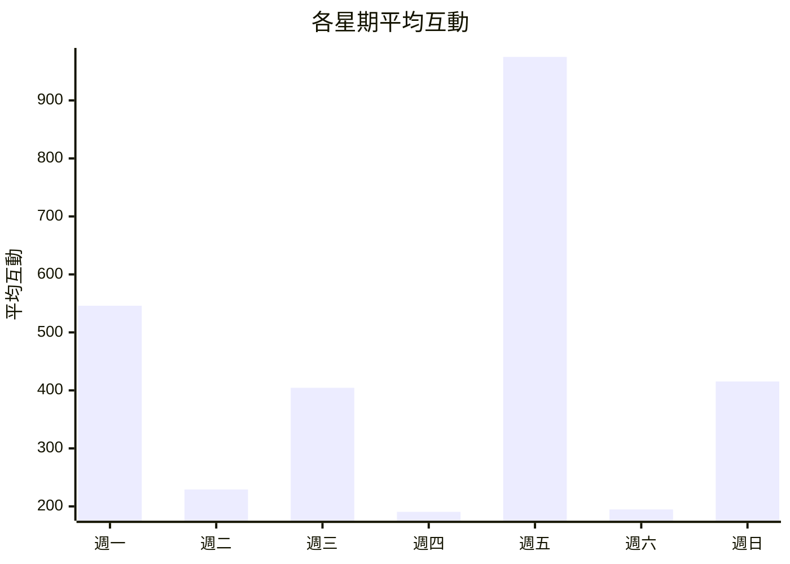
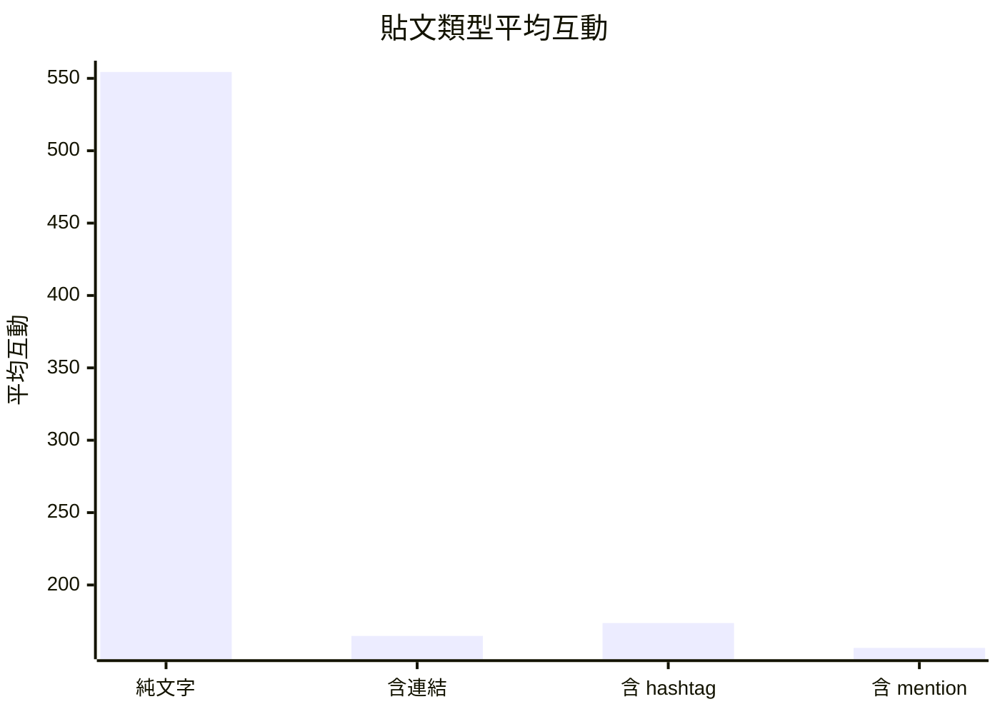
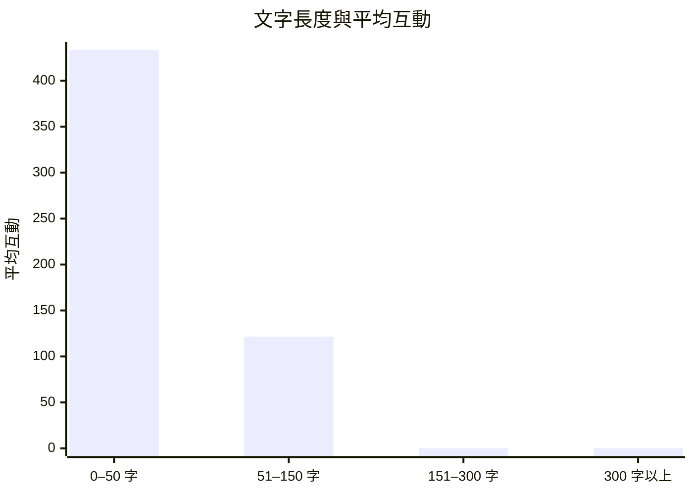

# @sample_creator 貼文互動分析報告

- 資料來源：`data/sample_posts.json`
- 樣本：40 篇（2026-09-29 ～ 2026-11-15，Asia/Taipei）
- 建議來源：規則模板

## 總覽指標

| 指標 | 平均 | 中位數 |
|---|---|---|
| 讚 | 380.3 | 200 |
| 留言 | 39.5 | 20 |
| 轉發 | 6.4 | 4 |
| 引用 | 1.4 | 1 |
| 互動 | 418.1 | 223.5 |
| 互動率（%） | 3.3 | 1.8 |
| 互動（排除異常值） | 311 | 217 |

粉絲數 12,500；每週約 5.9 篇；異常值 1 篇；欄位缺失 1 篇。

## Top 5 貼文（依互動率）

| # | 時間 | 內容 | 讚 | 留言 | 轉發+引用 | 互動率 |
|---|---|---|---|---|---|---|
| 1 | 11-06 18:48 | [如果只能推薦一本書給新手創作者，你會選哪本？](https://www.threads.com/@sample_creator/post/S030) | 4,200 | 380 | 15 | 36.76% |
| 2 | 10-25 21:54 | [大家覺得 AI 會取代設計師嗎？留言說說你的看法](https://www.threads.com/@sample_creator/post/S021) | 851 | 145 | 35 | 8.25% |
| 3 | 11-02 20:27 | [你最常用哪個 AI 寫作工具？我先說我的](https://www.threads.com/@sample_creator/post/S027) | 726 | 72 | 16 | 6.51% |
| 4 | 11-11 23:18 | [有人跟我一樣半夜最有靈感嗎？](https://www.threads.com/@sample_creator/post/S035) | 655 | 129 | 25 | 6.47% |
| 5 | 10-09 22:25 | [你最常用哪個 AI 寫作工具？我先說我的](https://www.threads.com/@sample_creator/post/S007) | 607 | 63 | 23 | 5.54% |

## 圖表

| 週一 | 週二 | 週三 | 週四 | 週五 | 週六 | 週日 |
|---|---|---|---|---|---|---|
| 546 | 229.2 | 404.5 | 190.6 | 975.1 | 194.7 | 415.3 |

| 純文字 | 含連結 | 含 hashtag | 含 mention |
|---|---|---|---|
| 554.4 | 164.8 | 173.7 | 156.5 |

| 0–50 字 | 51–150 字 | 151–300 字 | 300 字以上 |
|---|---|---|---|
| 433.7 | 121.5 | — | — |

- 發文最多：週二、18 時；平均互動最高：週五、18 時。
- 字數與互動的 Spearman 相關係數：0.12。
- 常見關鍵字：內容（4）、感謝（4）、分享（4）、重要（4）、工作（4）、ai（4）、工具（4）、思考（2）、期價值（2）、影音（2）
- 常見 hashtag：#創作日常（2）、#每週筆記（2）、#新企劃（2）、#感謝（2）

## 三群組成敗分析

分數：like + 2 × reply；分組：三分位數（P33 / P67）；代表貼文：每組 3–5 篇：high 取最高、low 取最低、mid 取最接近中位數；方法：jieba 斷詞 + TF-IDF 特徵詞（全帳號為語料）、文字特徵比例、詞典法情緒。

**高互動**（13 篇，分數 430–4,960）
- 如果只能推薦一本書給新手創作者，你會選哪本？（讚 4,200、留言 380）
- 大家覺得 AI 會取代設計師嗎？留言說說你的看法（讚 851、留言 145）
- 有人跟我一樣半夜最有靈感嗎？（讚 655、留言 129）
- 你最常用哪個 AI 寫作工具？我先說我的（讚 726、留言 72）
- 你最常用哪個 AI 寫作工具？我先說我的（讚 607、留言 63）

**中互動**（13 篇，分數 179–423）
- 小提醒：發文前先想清楚你想讓讀者做什麼（讚 200、留言 22）
- 跟 @design.lab 聊了一下午的品牌設計，收穫滿滿（讚 208、留言 19）
- 遠端工作兩年，我學到最重要的一件事（讚 193、留言 20）
- 整理了 10 個我每天用的效率工具 https://example.com/tools（讚 180、留言 19）
- 新企劃上線！感謝一路支持的大家 #新企劃 #感謝（讚 232、留言 20）

**低互動**（13 篇，分數 78–178）
- 抱歉昨天的直播延期了，改到週五晚上（讚 68、留言 5）
- 長文分享：經營社群最重要的是持續輸出與真誠互動，經營社群最重要的是持續輸出與真誠互動，經營社群最重要…（讚 73、留言 6）
- 限時分享：內容排程表範本 https://example.com/template（讚 98、留言 8）
- 感謝 @coffee.studio 的招待 ☕（讚 103、留言 9）
- 抱歉昨天的直播延期了，改到週五晚上（讚 117、留言 6）

成功因素：
- 以提問形式發文的比例較高（100% vs 0%），可能較容易引發回覆
- 文字較精簡（平均 19 字 vs 37 字）
- 高互動貼文的特徵詞：ai、常用、哪個、寫作、工具

失敗因素：
- 低互動組較常使用 emoji（20% vs 0%）
- 低互動組含連結比例較高（20% vs 0%），外連可能分散注意力
- 低互動組較常提及其他帳號（20% vs 0%）
- 低互動組負向語氣比例較高（40% vs 0%）
- 低互動貼文偏長（平均 37 字），可能降低閱讀完成率
- 低互動貼文的特徵詞：招待、抱歉、昨天、直播、延期

## 內容策略觀察與建議

### 1. 以提問結尾的貼文更容易引發回覆（P1，3 週）

- **觀察**：高互動代表貼文的提問比例 100%，低互動代表貼文為 0%；高互動組平均回覆 157.8，低互動組 6.8。
- **推測**：提問降低回覆門檻，讓讀者有明確的回應方向。
- **建議**：每週至少 3 篇貼文以開放式問題結尾。
- **驗證**：比較有提問與無提問貼文的平均回覆數，持續 3 週。

### 2. 週五發文的平均互動最高（P1，2 週）

- **觀察**：週五發文 7 篇，平均互動 975.1，是整體平均 418.1 的 2.3 倍（台北時間）。
- **推測**：此時段目標受眾較活躍；但樣本數少，也可能受個別爆文影響。
- **建議**：接下來兩週把重要貼文集中在週五發布。
- **驗證**：兩週後比較週五與其他時段的平均互動，差距仍 ≥ 1.2 倍才維持排程。

### 3. 含 mention的貼文互動較低（P2，2 週）

- **觀察**：含 mention貼文 4 篇平均互動 156.5，純文字貼文 26 篇為 554.4（0.3 倍）。
- **推測**：此形式可能讓讀者離開平台或顯得像廣告，降低互動意願。
- **建議**：減少含 mention的貼文，或把重點直接寫在內文。
- **驗證**：下 10 篇中一半採用此形式，比較兩組平均互動與回覆數。

### 4. 高互動貼文集中在特定主題（P2，4 週）

- **觀察**：高互動組（13 篇，分數 430–4960）的特徵詞為「ai、常用、哪個、寫作、工具」；低互動組（13 篇）分數僅 78–178。
- **推測**：這些主題與受眾興趣較契合；但特徵詞樣本少，需更多貼文確認。
- **建議**：規劃一系列圍繞「ai」的貼文。
- **驗證**：發布 5 篇相關主題貼文，檢查是否有 ≥ 3 篇落入高互動組。

### 5. 拆解最高互動貼文的寫法並複製（P3，2 週）

- **觀察**：互動最高的貼文總互動 4,595，是整體平均 418.1 的 11.0 倍（按讚 4,200、回覆 380）。
- **推測**：這篇的主題、開頭或形式特別吸引受眾；單篇結果可能有偶然性。
- **建議**：以相同主題或結構再發 2–3 篇變化版本。
- **驗證**：比較變化版本與帳號平均互動，至少 2 篇高於平均才視為可複製。

## 資料限制

- 曝光數僅帳號本人可見，無法取得；互動率以粉絲數為分母。
- 1 篇貼文有欄位缺失，平均值以有效樣本計算。
- 1 篇互動異常高（IQR 法），另提供排除異常值的平均。
- 時段分析使用台北時間（Asia/Taipei）。
